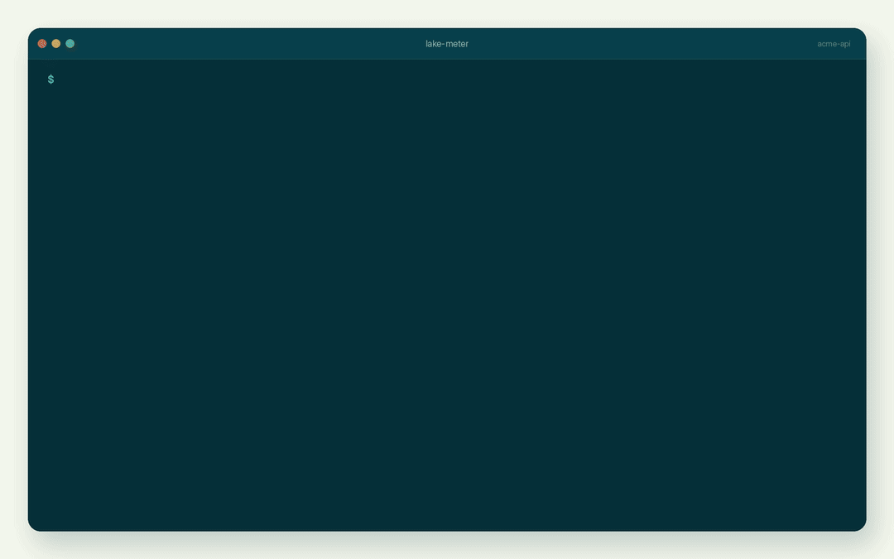

# lake-meter

**A model for every step, and a hard stop for every run. For Claude Code.**

Claude Code is great until a run loops, fans out into subagents, or quietly eats your 5‑hour window on a step a cheaper model could have done. `lake-meter` adds two things using only Claude Code's own extension points (hooks, statusline, skills, MCP):

1. **Model per step.** When Claude writes a plan in plan mode, lake-meter rates each step's complexity, recommends the cheapest model that should handle it (Haiku / Sonnet / Opus), and estimates tokens and dollars per step and in total, next to the cost of running everything on Opus. The table appears inside Claude Code's own "Ready to code?" plan dialog.
2. **A per-run cap that stops and asks.** Set `$5` (or a token budget, or a % of your 5‑hour window). When a run reaches it, the next tool call becomes a permission prompt: **Yes** continues with +50% headroom, **No** stops Claude right there. In unattended modes it ends the turn instead.
3. **An end-of-run receipt.** Measured tokens and list-price dollars for the run, split by model and subagents, compared with the plan's estimate.

Local only. No account, no server, **no telemetry**.

```bash
npx lake-meter init
```

That's the whole install. Restart Claude Code (or open `/hooks`) and work as usual.



---

## What you see

**In plan mode**, at the top of the plan dialog:

```
Ready to code?
Here is Claude's plan:
▎ Lake Meter estimate: $3.53–$13.0 with a model per step, vs $3.96–$14.5 all on Opus 5.5. Table at the end.
```

and at the end of the plan:

```
┌─────┬─────────────────────────────────────┬────────────┬─────────────────────┬───────────┬─────────────┐
│ #   │ Step                                │ Complexity │ Recommended model   │ Tokens    │ Est. cost   │
├─────┼─────────────────────────────────────┼────────────┼─────────────────────┼───────────┼─────────────┤
│ 1   │ Add retry settings to config        │ 1/5        │ Haiku 5.5 (haiku)   │ 40k–161k  │ <$0.01      │
│ 2   │ Design an idempotent delivery queue │ 5/5        │ Opus 5.5 (opus)     │ 1.5M–6.2M │ $2.10–$8.22 │
│ 3   │ Implement the retry worker          │ 4/5        │ Opus 5.5 (opus)     │ 720k–2.6M │ $1.01–$3.38 │
│ 4   │ Expose delivery status in the API   │ 3/5        │ Sonnet 5.5 (sonnet) │ 284k–1.0M │ $0.21–$0.71 │
│ 5   │ Tests for failure paths             │ 3/5        │ Sonnet 5.5 (sonnet) │ 284k–1.0M │ $0.21–$0.71 │
│ 6   │ Update the changelog                │ 1/5        │ Haiku 5.5 (haiku)   │ 40k–161k  │ <$0.01      │
└─────┴─────────────────────────────────────┴────────────┴─────────────────────┴───────────┴─────────────┘
Total: $3.53–$13.0 vs $3.96–$14.5 with everything on Opus 5.5 (about 10% less).
```

**When the cap is reached**, before the next tool call:

```
│ Hook PreToolUse:Bash requires confirmation for this command:
│ Lake Meter: this run has used about $2.15 (cap $2.00). Approve to continue with +$1.00 headroom.
│ Deny to stop here. Or run /meter cap <usd> to set a new cap. [settings]
 Do you want to proceed?
 ❯ 1. Yes
   2. No
```

**When the run ends:**

```
Stop says: Lake Meter · run $3.44 · 524k tok (313k cache reads, 155k out) · Opus 5.5 $3.44 · cap $7.00
           Since plan approved: $3.25 measured vs $3.53–$13.0 estimated
```

**All the time**, in the statusline: `◒ Lake · run $0.65 / $5.00 · session $4.54 · 5h 42%`

(These are copied from a real Claude Code 2.1.322 session; see [Verification](#verification).)

## Commands

| | |
|---|---|
| `npx lake-meter init` | install hooks, statusline, `/meter` skill and two optional subagents into `~/.claude` |
| `npx lake-meter init --project` | install into this repo's `.claude/settings.local.json` instead |
| `npx lake-meter init --cap 10 --no-agents --statusline` | set the cap, skip the subagents, replace an existing statusline |
| `/meter`, `/meter cap 10`, `/meter cap off`, `/meter report` | inside Claude Code (uses one short model turn to display) |
| `lake-meter cap 10` · `lake-meter status` · `lake-meter report` | same, from any terminal, no model turn |
| `lake-meter plan plan.md [--why] [--openai] [--json]` | plan breakdown for any markdown plan |
| `lake-meter mcp` | MCP server with `estimate_plan` and `meter_status` (works in Cursor too) |
| `npx lake-meter uninstall` | remove everything `init` added (your settings are restored; a backup is kept as `settings.json.lake-meter.bak`) |

### Config

`~/.lake-meter/config.json` (per-project override: `.lake-meter.json` in the repo root):

```json
{
  "capUsd": 5,            // per run, API list-price equivalent. null = off
  "capTokens": null,      // per run, all tokens incl. cache reads
  "capFiveHourPct": null, // e.g. 80: stop when your 5-hour subscription window passes 80% (needs the statusline)
  "sessionCapUsd": null,  // across the whole session
  "onCap": "ask",         // "ask" = permission prompt; "stop" = end the turn
  "extendPct": 50,        // headroom granted when you press Yes
  "warnPct": 80,          // one heads-up (to you and to Claude) at 80% of the cap
  "provider": "anthropic",// or "openai" for plan recommendations
  "annotatePlans": true   // add the table to plan files in plan mode
}
```

A **run** is everything from one prompt you submit until Claude stops.

### Cursor and other MCP clients

```json
// ~/.cursor/mcp.json
{ "mcpServers": { "lake-meter": { "command": "npx", "args": ["-y", "lake-meter", "mcp"] } } }
```

Then ask the agent to "estimate this plan with lake-meter". In Cursor you get the per-step model and cost breakdown. The cap and the receipt are Claude Code only, because Cursor doesn't expose per-run token usage to extensions.

## Measured vs estimated (read this)

| | How | Accuracy |
|---|---|---|
| **Tokens per run** | **Measured.** Read from Claude Code's session transcript (`message.usage` on each response, de-duplicated by message id) plus subagent transcripts in `<session>/subagents/`. | Exact as reported by the API, up to transcript write lag (see limits). |
| **Dollars per run** | **Computed** from measured tokens × list prices in [`src/prices.json`](src/prices.json), per request, including cache writes (5m/1h), cache reads and Haiku's long-context tier. | Matches Claude Code's own `total_cost_usd` in our tests. It's an **API-equivalent** figure: on Pro/Max you don't pay it per token; it tells you how heavy a run was. Your invoice can differ (discounts, batch, regions). |
| **5-hour window %** | **Reported by Claude Code** to the statusline (`rate_limits.five_hour.used_percentage`, Pro/Max only). | As accurate as Claude Code's own number. |
| **Plan breakdown** | **Estimate.** Keyword and size heuristics rate each step 1–5; token budgets per complexity live in `prices.json` (`assumptions`). Run `lake-meter plan plan.md --why` to see every reason. | Rough. Ranges are wide on purpose. Tune the budgets from your own `lake-meter report` history. |
| **Model recommendation** | **Opinion**, encoded as complexity → tier (1–2 Haiku, 3 Sonnet, 4–5 Opus). Frontier models are never recommended by default. | A starting point, not a guarantee of quality. |

Prices last verified **2026‑11‑12** from [Anthropic pricing](https://platform.claude.com/docs/en/about-claude/pricing) and [OpenAI pricing](https://developers.openai.com/api/docs/pricing). To update, edit `src/prices.json`, or drop an override at `~/.lake-meter/prices.json` with the same shape.

## How it works

`init` copies a pinned runtime to `~/.lake-meter/runtime` (so hooks run in ~50 ms with plain `node`, no `npx` per call) and adds to your Claude Code settings:

| Extension point | What lake-meter does |
|---|---|
| `UserPromptSubmit` hook | marks the start of a run |
| `PreToolUse` hook (`*`) | reads new transcript bytes, prices them, and returns `permissionDecision: "ask"` when the cap is reached (or `continue: false` in `bypassPermissions` / `dontAsk` / `onCap: "stop"`). On `ExitPlanMode` it records the plan estimate and gives Claude a one-line note about cheaper subagents |
| `PostToolUse` hook (`*`) | if the tool we asked about ran, you pressed Yes, so headroom is added. When Claude writes a plan file in plan mode, appends the per-step table to it |
| `Stop` hook | prints the receipt (`systemMessage`, never blocks) and appends one line to `~/.lake-meter/runs.jsonl` |
| `statusLine` | shows the meter and stores Claude Code's own session cost and rate-limit % for the window cap. Only installed if you don't already have a statusline |
| `~/.claude/skills/meter` | the `/meter` command |
| `~/.claude/agents/lake-light.md`, `lake-standard.md` | optional subagents pinned to `haiku` and `sonnet`, so the per-step advice is actionable. Claude only uses them if it decides to; skip with `--no-agents` |

## Limits (honest list)

- **The cap is checked before each tool call.** A single long model response can overshoot it, and the final text answer of a turn isn't gated. Expect a run to end slightly above the cap.
- **Transcript lag.** Claude Code writes transcripts asynchronously, so the newest response may land a moment late. Spend can lag by about one response.
- **Pressing No interrupts the turn.** Claude Code doesn't run Stop hooks on interrupts, so there's no receipt for that turn; `lake-meter status` still has the numbers.
- **"Run" = one submitted prompt.** Background subagent reports and `/loop` iterations also fire `UserPromptSubmit` and start a new run; use `sessionCapUsd` to bound the whole session.
- **Dollar figures are list-price equivalents**, not your bill. On subscriptions use `capTokens` or `capFiveHourPct` if dollars feel abstract.
- **Plan breakdown is heuristic** and English-keyword based. Unknown models count tokens but not dollars (and the receipt says so).
- **`/meter` costs one short model turn** because skills run through the model; the CLI commands don't.
- Claude Code only for caps and receipts. Cursor, Codex and others get the MCP plan estimate.

## Privacy

Step titles are stored locally in `~/.lake-meter`, along with config and a run log of token and dollar totals. Nothing leaves the machine. No prompts or code are stored. lake-meter makes **no network requests**, and there's no telemetry. Debugging: `touch ~/.lake-meter/debug` logs raw hook inputs locally to `~/.lake-meter/debug.jsonl`; delete the file to stop.

## Verification

- `npm test`: 38 tests (pricing math, transcript parsing and de-duplication, plan splitting and scoring, every hook path, install/uninstall round-trip, MCP over stdio, a simulated session through the real CLI).
- `test/real-claude.test.js` runs the **real Claude Code binary** (2.1.322 at time of writing) against a local mock of the Messages API (`scripts/mock-anthropic.js`, no account needed). It checks that the hooks fire, the cap produces a permission decision, `bypassPermissions` stops the turn, and that lake-meter's measured run cost equals Claude Code's own `total_cost_usd`. Skipped when no Claude Code binary is installed.
- The screens in [What you see](#what-you-see) were captured from an interactive Claude Code session driven against the same mock.

## Demo (no account needed)

```bash
npm run demo        # simulated session: plan breakdown → cap prompt → receipt
```

## Teams

Works with [lake-gate](https://getlake.github.io/lake-gate/): a teammate approves the plan before the expensive run. Shared caps and a dashboard of runs by repo and model are in early access. [Request a team pilot](https://getlake.github.io/lake-meter/#waitlist).

## License

MIT © Lake
